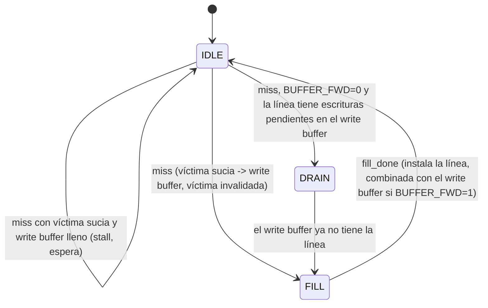
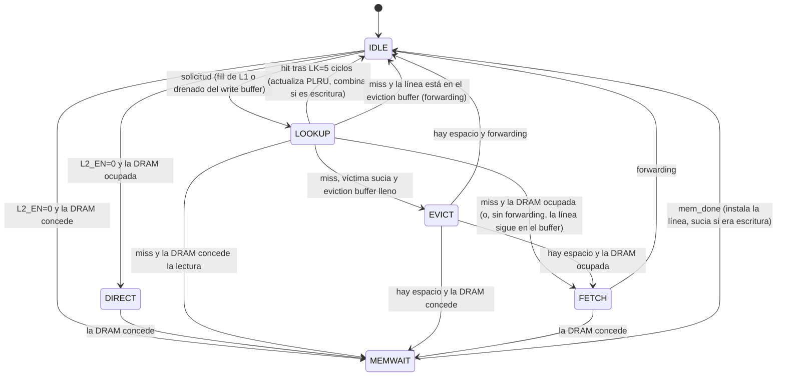
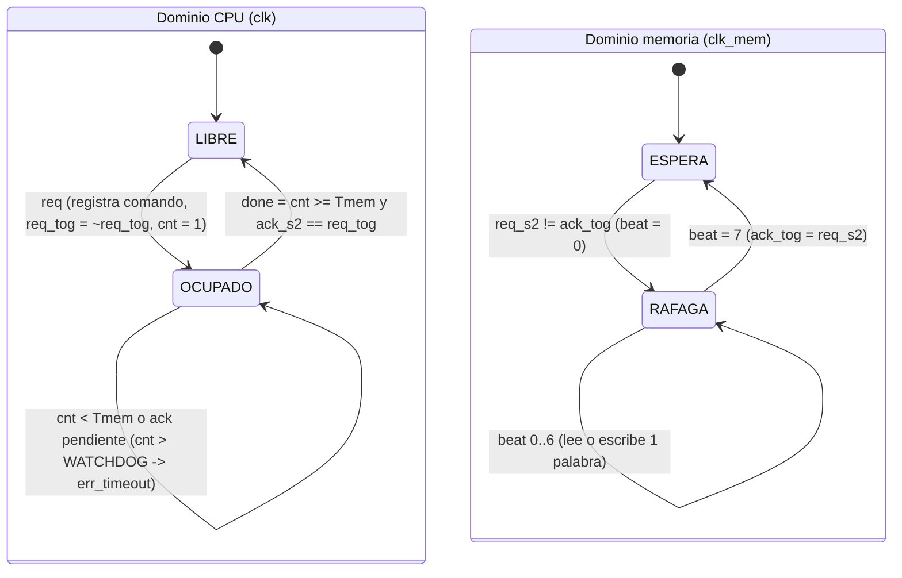

# Jerarquía de memoria de datos (Proyecto II)

El Proyecto II separa instrucciones y datos (Harvard). Las instrucciones salen de una ROM
síncrona de 64 KB que responde en 1 ciclo y nunca falla. Los datos pasan por dos niveles de
caché antes de llegar a una DRAM con reloj propio. La ISA, el formato de bundle y las
distancias del planificador no cambian; un fallo solo agrega ciclos de stall (sección 8).

```
                  CP / AP (etapa EX)
                         |
                  +------v------+  hit: 0 ciclos de stall
                  |    L1-D     |  4 KB, 2 vías, LRU
                  +--+-------+--+
          fill (lectura)     |  víctima sucia (WB) o cada AP (WT)
                     |   +---v-----------+
                     |   | write buffer  |  4 líneas, merging, forwarding
                     |   +---+-----------+
                  +--v-------v--+
                  | árbitro L2  |  fill de L1 > drenado del write buffer
                  +------+------+
                  +------v------+  hit: 8 ciclos de stall
                  |     L2      |  16 KB, 4 vías, Tree-PLRU, inclusiva (fija)
                  +--+-------+--+
          lectura    |       |  víctima sucia
                     |   +---v--------------+
                     |   | eviction buffer  |  8 líneas, dirty-line forwarding
                     |   +---+--------------+
                  +--v-------v--+
                  | árbitro DRAM|  lectura de L2 > drenado del eviction buffer
                  +------+------+
  ---- clk (100 MHz) ----|---- handshake de 2 fases, sincronizadores de 2 FF ----
                  +------v------+
                  |  dram_ctrl  |  64 KB, clk_mem = 25 MHz, Tmem = 53 ciclos de CPU por línea
                  +-------------+
```

| Archivo | Módulo |
|---|---|
| `rtl/mem_subsystem.sv` | une los niveles, los dos árbitros, el modo de operación y los contadores del Cuadro 2 |
| `rtl/l1d_cache.sv` | L1-D |
| `rtl/write_buffer.sv` | buffer de escritura L1 → L2 |
| `rtl/l2_cache.sv` | L2 unificada |
| `rtl/eviction_buffer.sv` | buffer de desalojo L2 → DRAM |
| `rtl/dram_ctrl.sv` | memoria principal y cruce de dominio de reloj |
| `rtl/clk_div.sv` | genera `clk_mem = clk / MEM_CLK_DIV` |
| `rtl/perf_counters.sv` | contadores del pipeline (Cuadro 1) |

## 1. Parámetros

| Parámetro | L1-D | L2 | DRAM |
|---|---|---|---|
| Capacidad | 4 KB | 16 KB | 64 KB |
| Asociatividad | 2 vías | 4 vías | — |
| Línea | 32 B (8 palabras) | 32 B | ráfaga de 8 palabras |
| Conjuntos | 64 | 128 | — |
| Reemplazo | LRU real (1 bit por conjunto) | Tree-PLRU (3 bits por conjunto) | — |
| Escritura | write-back + write-allocate (por omisión) o write-through + no-write-allocate | write-back + write-allocate | — |
| Latencia | hit en 1 ciclo, sin stall | 8 ciclos de stall (miss L1, hit L2) | Tmem = 25 + 7·DIV = 53 ciclos de CPU |

Parámetros de `top` / `tb_top` (se eligen con `CFG=` en el `Makefile`):

| Parámetro | Por omisión | Efecto |
|---|---|---|
| `MODE` | 3 | 0 memoria ideal de 1 ciclo, 1 sin caché, 2 solo L1-D, 3 L1-D + L2 |
| (inclusiva) | fija | L2 siempre inclusiva con invalidación hacia atrás |
| `L1_WT` | 0 | 0 write-back + write-allocate, 1 write-through + no-write-allocate |
| `BUFFER_FWD` | 1 | 1 forwarding desde los buffers, 0 esperar a que se drenen |
| `WB_DEPTH` / `EB_DEPTH` | 4 / 8 | entradas del write buffer y del eviction buffer |
| `MEM_CLK_DIV` | 4 | fmem = fcpu / DIV: 2 → 50 MHz (Tmem = 39), 4 → 25 MHz (53), 5 → 20 MHz (60) |
| `T_FIRST` | 25 | ciclos de CPU hasta la primera palabra |
| `L2_HIT` | 8 | ciclos de stall de un miss de L1 que acierta en L2 |

## 2. Descomposición de la dirección

El subsistema usa `addr[15:0]` (64 KB). Las palabras son de 32 bits, big-endian y alineadas.

```
L1-D   15        11 10            5 4      2 1  0
      +------------+---------------+--------+----+
      |  tag (5)   |  índice (6)   | pal(3) | 00 |     64 conjuntos x 2 vías x 32 B = 4 KB
      +------------+---------------+--------+----+

L2     15     12 11               5 4           0
      +---------+------------------+-------------+
      | tag (4) |   índice (7)     | offset (5)  |     128 conjuntos x 4 vías x 32 B = 16 KB
      +---------+------------------+-------------+
```

Cálculo de los campos:

- offset = log2(32) = 5 bits, de los cuales `addr[4:2]` eligen la palabra.
- índice L1 = log2(4096 / (32·2)) = log2(64) = 6 bits; tag L1 = 16 − 6 − 5 = 5 bits.
- índice L2 = log2(16384 / (32·4)) = log2(128) = 7 bits; tag L2 = 16 − 7 − 5 = 4 bits.

Costo de almacenamiento:

| | Datos | Tag | Válido + sucio | Reemplazo | Total |
|---|---|---|---|---|---|
| L1-D (128 líneas) | 32 768 b | 640 b | 256 b | 64 b | 33 728 b (≈ 4.1 KB) |
| L2 (512 líneas) | 131 072 b | 2 048 b | 1 024 b | 384 b | 134 528 b (≈ 16.4 KB) |

Dos direcciones a 2 KB de distancia caen en el mismo conjunto de L1, y a 4 KB en el mismo
conjunto de L2. Los benchmarks `stride_*` y la prueba dirigida de `tb_l2_coherence` aprovechan
esto para forzar conflictos.

## 3. Políticas de escritura

**L1 write-back + write-allocate (`L1_WT = 0`, por omisión).**

- Un `AP` que acierta escribe la palabra en L1 y marca la línea sucia.
- Un `AP` que falla trae la línea (como un `CP`) y luego escribe.
- La víctima sucia sale al write buffer en el mismo ciclo del miss, con máscara `0xFF`. Si el
  buffer está lleno, el acceso espera (`l1_wb_full_stall`).

**L1 write-through + no-write-allocate (`L1_WT = 1`).**

- Todo `AP` encola su palabra en el write buffer (máscara de 1 bit). Si además acierta en L1,
  actualiza la copia en L1.
- Un `AP` que falla **no** trae la línea; solo detiene el pipeline si el write buffer está lleno.
- No hay líneas sucias en L1: un desalojo nunca genera tráfico.

**L2 write-back + write-allocate.**

- El drenado del write buffer llega a L2 como escritura de línea con máscara.
- Si acierta, combina las palabras y marca la línea sucia.
- Si falla, trae la línea de la DRAM (o del eviction buffer), combina y la instala sucia.

## 4. Reemplazo

**L1-D: LRU real.** Con 2 vías basta 1 bit por conjunto (`lru[i]` = vía menos usada).

- Un hit o un fill en la vía `w` deja `lru[i] = !w`.
- La víctima es la primera vía inválida y, si las dos son válidas, la indicada por `lru[i]`.

**L2: Tree-PLRU de 3 bits.** `b0` es la raíz, `b1` decide entre las vías 0/1 y `b2` entre las
vías 2/3. Cada acceso hace que los bits del camino apunten lejos de la vía usada; la víctima se
encuentra siguiendo los bits.

```
            b0
     0 /         \ 1           víctima: b0 = 0 -> mirar b1, b0 = 1 -> mirar b2
      b1           b2          acceso a la vía 0: b0 = 1, b1 = 1
   0 /  \ 1     0 /  \ 1       acceso a la vía 1: b0 = 1, b1 = 0
  v0     v1    v2     v3       acceso a la vía 2: b0 = 0, b2 = 1
                               acceso a la vía 3: b0 = 0, b2 = 0
```

Las vías inválidas se llenan antes de usar el árbol. `tb_l2_coherence` verifica la secuencia de
víctimas del PLRU con accesos dirigidos al mismo conjunto.

## 5. Inclusión (política fija)

La L2 es **siempre inclusiva** (justificación en `docs/l2-coherencia.md`). Todo fill de L1
pasa por L2, y L2 instala la línea: al entrar
a L1 una línea también está en L2. Cuando L2 desaloja una víctima válida:

1. En el miss de L2, L2 levanta `snoop_req` con su dirección de línea.
2. L1 la busca de forma combinacional y la invalida si la tiene.
3. Si la copia de L1 estaba sucia, sus datos (`snoop_line`) reemplazan a los de L2 en la víctima.
   La víctima queda sucia y entra al eviction buffer, así que no se pierde ninguna escritura.

Así se mantiene el invariante L1 ⊆ L2. El costo es que una línea muy usada en L1 puede salir
porque L2 la eligió como víctima (contador `inv_atras` / `back_inv`). L1 cabe en L2 (4 KB
dentro de 16 KB), así que la inclusión es barata en uninúcleo y permite demostrar la
invalidación hacia atrás que pide el enunciado.

`tb_l2_coherence` usa la secuencia A, B, A, C, A, D, A, E en un mismo conjunto de L2: A sale
de L1 aunque L1 la acaba de usar; si estaba sucia, viaja al eviction buffer y vuelve por
forwarding. Detalle en `docs/l2-coherencia.md`.

## 6. Buffers y forwarding

**Write buffer (L1 → L2, `WB_DEPTH = 4` líneas).**

- Cada entrada es una línea de 32 B con máscara de palabras válidas.
- *Write merging*: en write-through, un `AP` a una línea que ya está pendiente se combina en esa
  entrada (`wb_merges`). La entrada que está drenando (`head_busy`) ya no acepta combinaciones.
- Drena en segundo plano: el árbitro de L2 le da paso cuando L1 no está pidiendo un fill.
- *Forwarding* en el fill (`BUFFER_FWD = 1`): si la línea que L1 trae tiene palabras pendientes
  en el buffer, se combinan de la más vieja a la más nueva sobre la línea que llega de L2
  (`l1_fwd_fill`). Así L1 nunca instala una versión vieja.
- Con `BUFFER_FWD = 0`, L1 pasa a `S_DRAIN` y espera a que esas entradas lleguen a L2 antes de
  pedir la línea (`l1_drain_wait`).

**Eviction buffer (L2 → DRAM, `EB_DEPTH = 8` líneas).**

- L2 empuja la víctima sucia en el mismo ciclo del miss y arranca la lectura a la DRAM de
  inmediato. La escritura de la víctima no está en el camino crítico.
- *Dirty-line forwarding*: si un miss de L2 pide una línea que sigue en el buffer, se toma la
  copia más reciente sin ir a la DRAM (`eb_fwd`). Con `BUFFER_FWD = 0`, L2 espera a que se drene.
- Si el buffer está lleno, L2 se queda en `S_EVICT` hasta que haya espacio (`eb_full_wait`).
- `eb_max_occupancy` registra la ocupación máxima.

**Riesgo RAW en memoria (mecanismo elegido).** Un `CP` puede pedir una palabra cuya escritura
más reciente todavía no llegó al nivel inferior:

- está en el write buffer (víctima sucia de L1 o `AP` write-through); o
- está en el eviction buffer (víctima sucia de L2).

Si el fill leyera solo de L2 o de la DRAM, el `CP` vería un valor viejo. El mecanismo
elegido, por omisión, es el **forwarding**:

- el fill de L1 combina las palabras pendientes del write buffer sobre la línea que llega;
- el miss de L2 toma la línea del eviction buffer en vez de la DRAM.

La lectura ve siempre la última escritura y no paga ciclos extra. La alternativa medida
(`CFG=nofwd`) es **esperar el drenado**: L1 pasa a `S_DRAIN` y L2 a `S_FETCH` hasta que las
entradas de esa línea salen del buffer. Es igual de correcta, pero el `CP` paga el drenado. Un
hit en L1 no necesita ninguno de los dos mecanismos: con write-back L1 tiene la copia más
reciente, y con write-through el `AP` actualiza L1 además de encolar la palabra.
`tb_l1d`, `tb_buffers` y el estrés aleatorio de `tb_l2_coherence` cubren los dos mecanismos.

**Árbitros.** La demanda tiene prioridad sobre el tráfico de fondo:

- En L2, el fill de L1 va antes que el drenado del write buffer.
- En la DRAM, la lectura de L2 va antes que el drenado del eviction buffer.

Un drenado que ya empezó termina antes de atender la siguiente solicitud.

## 7. Memoria principal y cruce de dominio de reloj

`dram_ctrl` tiene dos dominios:

- **CPU (`clk`, 100 MHz).** Acepta una solicitud de línea cuando está libre, registra el comando
  (estable hasta `done`) y alterna `req_tog`.
- **Memoria (`clk_mem`, 25 MHz).** Sincroniza `req_tog` con 2 flip-flops. Al ver el cambio hace
  la ráfaga de 8 palabras (1 por flanco de `clk_mem`) y alterna `ack_tog`.

El lado CPU sincroniza `ack_tog` con 2 flip-flops. `done` sube cuando se cumplen las dos
condiciones: el contador llegó a Tmem y el ack ya cruzó.

Tmem = Tfirst + 7·DIV = 25 + 7·4 = 53 ciclos de CPU por línea.

El contador fija la latencia del modelo del enunciado; el handshake garantiza que el dato
realmente cruzó. El bus `mline` es estable desde antes de que el ack llegue al lado CPU.

Si el ack no llega en `WATCHDOG` = 1000 ciclos, se levanta `err_timeout` y la simulación lo
informa. `tb_dram_ctrl` se compila con DIV = 2, 4 y 5 y comprueba la latencia exacta (39, 53 y
60), la escritura con máscara y que el watchdog nunca se dispara. `clk_div` corre libre desde el
arranque, así que el dominio de memoria tiene flancos incluso durante el reset.

```
clk      _|‾|_|‾|_|‾|_|‾|_|‾|_|‾|_|‾|_|‾|_|‾|_ ... _|‾|_|‾|_
req_tog  ____/‾‾‾‾‾‾‾‾‾‾‾‾‾‾‾‾‾‾‾‾‾‾‾‾‾‾‾‾‾‾‾‾‾ ... ‾‾‾‾‾‾‾‾      (CPU alterna)
clk_mem  ___/‾‾‾‾‾‾‾\_______/‾‾‾‾‾‾‾\_______/‾‾ ... 
req_s2   __________________/‾‾‾‾‾‾‾‾‾‾‾‾‾‾‾‾‾‾ ... ‾‾‾‾‾‾‾‾      (2 FF en clk_mem)
beat               0 1 2 ... 7  (1 palabra por flanco de clk_mem)
ack_tog  _________________________________ ... __/‾‾‾‾‾‾‾‾      (MEM alterna al terminar)
ack_s2   ________________________________________ ... ___/‾‾‾‾  (2 FF en clk)
done     ________________________________________ ... _____/‾\_ (cnt >= Tmem y ack_s2 == req_tog)
```

## 8. Tiempos vistos por el pipeline

La caché trabaja en EX. Un `CP`/`AP` que no puede completarse levanta `dmem_stall` y el pipeline
se congela en *lockstep* (detalles en `microarchitecture.md`, sección 3).

| Evento | Ciclos de stall | Comprobado en |
|---|---|---|
| Hit en L1-D | 0 | `tb_l1d`, `tb_l2_coherence` |
| Miss L1, hit L2 | 8 (L1 usa 3: detección, solicitud, llenado; L2 busca 5) | `tb_l2_coherence` |
| Miss L1, miss L2 | 8 + Tmem = 61, más la contención si la DRAM está ocupada drenando | `tb_l2_coherence` |
| Miss L1, línea en el eviction buffer | 8 (forwarding) | `tb_l2_coherence` |
| Solo L1 (`MODE = 2`), miss | 3 + Tmem = 56 | corridas `l1` |
| Sin caché (`MODE = 1`), cada `CP`/`AP` | Tmem = 53 | `tb_feistel_stall`, corridas `nocache` |
| `AP` en write-through con el write buffer lleno | hasta que se libere una entrada | `tb_l1d_wt` |

## 9. Máquinas de estados

### L1-D (`l1d_cache.sv`)



Mientras `state != IDLE`, `stall = 1`. Al volver a `IDLE`, el mismo `CP`/`AP` se reevalúa y ahora
acierta. El contador `counted` evita que esa repetición se cuente dos veces. La invalidación
hacia atrás (snoop) se atiende en cualquier estado y bloquea un acceso nuevo en el mismo ciclo.

### L2 (`l2_cache.sv`)



En el ciclo del miss (fin de `LOOKUP`) ocurren tres cosas a la vez:

- Se elige la víctima.
- Si la política es inclusiva, se manda el snoop a L1 y se recogen sus datos si estaban sucios.
- Se empuja la víctima sucia al eviction buffer.

### Controlador de DRAM (`dram_ctrl.sv`)



## 10. Contadores (Cuadros 1 y 2 del enunciado)

`tb_top` imprime un resumen y, con `+STATS=archivo.json`, vuelca todos los contadores:

```
PERF modo=3 instr=... ipc=... stall_l1d=... stall_saltos=... L1_hit=..% L2_hit=..% dram=... inv_atras=...
```

| Clave en el JSON | Origen | Significado |
|---|---|---|
| `cycles`, `bundles`, `instr`, `ipc` | `perf_counters` | ciclos hasta `FIN`, bundles que terminan EX, instrucciones no-NOP, IPC = instr / ciclos |
| `stall_l1d`, `stall_events` | `perf_counters` | ciclos con `dmem_stall` y número de accesos que detuvieron el pipeline |
| `stall_branch` | `perf_counters` | ciclos perdidos por saltos tomados (2 bundles descartados por salto) |
| `stall_l2`, `stall_dram`, `stall_other` | `mem_subsystem` | reparto de los ciclos de stall según de dónde vino la línea (L2 o eviction buffer, DRAM, write buffer lleno o snoop) |
| `l1_rd_acc`, `l1_wr_acc`, `l1_rd_hit`, `l1_rd_miss`, `l1_wr_hit`, `l1_wr_miss`, `l1_hit_rate` | `l1d_cache` | accesos y aciertos de L1 (una vez por instrucción) |
| `l1_dirty_evict`, `l1_fwd_fill`, `l1_wb_full_stall`, `l1_drain_wait` | `l1d_cache` | víctimas sucias, fills combinados con el write buffer, esperas por buffer lleno o por drenado |
| `l2_acc`, `l2_rd_acc`, `l2_wr_acc`, `l2_hit`, `l2_miss`, `l2_hit_rate` | `l2_cache` | accesos de L2: fills de L1 (lecturas) y drenados del write buffer (escrituras) |
| `back_inv`, `l2_snoops` | `l1d_cache`, `l2_cache` | invalidaciones hacia atrás que sacaron una línea de L1 / snoops enviados |
| `l2_dirty_evict`, `eb_fwd`, `eb_full_wait` | `l2_cache` | víctimas sucias, forwarding desde el eviction buffer, esperas por buffer lleno |
| `wb_pushes`, `wb_merges`, `eb_pushes`, `eb_max_occupancy` | buffers | uso de los buffers |
| `dram_reads`, `dram_writes`, `dram_busy`, `dram_bw_util`, `dram_bytes` | `dram_ctrl` | transferencias de línea, ciclos ocupados, utilización (= busy / ciclos) y bytes movidos |
| `dram_timeout` | `dram_ctrl` | watchdog del cruce de dominio (debe ser 0) |

## 11. Verificación

| Prueba | Comando | Qué comprueba |
|---|---|---|
| `tb_dram_ctrl` (DIV 2, 4, 5) | `make unit` | Tmem exacto, ráfaga con máscara, contadores, sin watchdog |
| `tb_buffers` | `make unit` | merging, lleno, cabeza en vuelo, forwarding de la palabra más nueva, orden FIFO |
| `tb_l1d` (WB, WT, sin forwarding) | `make unit` | hit sin stall, LRU, políticas de escritura, víctima sucia, fill combinado o espera de drenado, snoop |
| `tb_l2_coherence` (varias configuraciones × 3 semillas) | `make coherence` | latencias 0/8/61, PLRU, invalidación hacia atrás, forwarding del eviction buffer; estrés aleatorio contra un modelo de oro y vista coherente final de los 64 KB |
| `tb_stall_lockstep` | `make stall-test` | los 9 programas con stalls aleatorios (3 semillas) dan los mismos registros y memoria, sin riesgos |
| `tb_feistel_stall` | `make feistel-stall` | `AUTH`/`LOADKEY`/`FROUND` bajo misses continuos en 5 jerarquías distintas contra la memoria ideal |
| Programas en todas las configuraciones | `make progs-all` | los `.expect` de P1 y P2 en `ideal`, `nocache`, `l1`, `base`, `wt`, `nofwd`, `div2`, `div5` |
| Benchmarks | `make bench` | matriz configuración × optimización del compilador, cada corrida verificada con su `.expect` (`performance-analysis.md`) |
