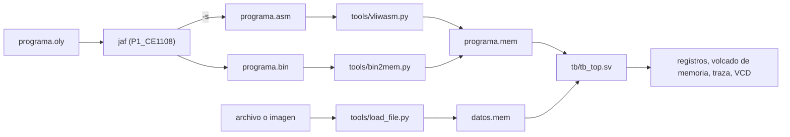

# Integración con el compilador JAF

Contrato entre el procesador Feistel4-VLIW (repositorio `vliw_grupo2`) y el
compilador JAF (repositorio `P1_CE1108`).

Este documento fija todo lo que el compilador necesita saber del procesador y que no está en
la codificación de instrucciones: convención de registros, marco de pila, mapa de memoria,
formatos de archivo, sintaxis del ensamblador y reglas de calendarización.

## 1. Alcance y referencias

| Tema | Dónde está definido |
|---|---|
| Codificación y semántica de cada instrucción | `docs/isa.md`, incluida la adenda v1.1 (resumida en la sección 12 mientras se integra a `isa.md`) |
| ABI, memoria, formatos, sintaxis y latencias | este documento |
| Implementación de referencia de la sintaxis y de los formatos `.mem` / `.bin` / `.lst` | `tools/vliwasm.py` |
| Cómo se carga y se corre un programa | `tb/tb_top.sv` y el `Makefile` |

Cualquier cambio que afecte al compilador se comunica con un issue en ambos repositorios
antes de fusionarlo a `develop`.

## 2. Flujo entre los dos repositorios



El compilador entrega un `.bin`. El lado VLIW lo convierte a `.mem` y lo corre en el RTL.
El `.asm` que genera `jaf -s` también es entrada válida de `vliwasm.py`; esto permite la
prueba cruzada.

## 3. Convención de registros (ABI)

| Registro | Alias | Uso |
|---|---|---|
| `r0` | `zero` | Siempre vale 0; las escrituras se descartan |
| `r1` | — | Valor de retorno de una función | 
| `r2`–`r7` | — | Reservados; el compilador no los usa (quedan para ensamblador escrito a mano) |
| `r8`–`r23` | — | Temporales de expresiones. Los guarda quien llama |
| `r24`–`r27` | — | Uso interno del compilador para cálculo de direcciones | 
| `r28` | `gp` | Puntero global, fijo en `0x10000` | 
| `r29` | `sp` | Puntero de pila |
| `r30` | `fp` | Puntero de marco |
| `r31` | `ra` | Dirección de retorno; la escribe `SYE` | 

`vliwasm.py` acepta los alias `zero`, `gp`, `sp`, `fp` y `ra` en lugar del número de registro.

## 4. Llamadas a función y marco de pila

### 4.1 Instrucciones

- Llamada: `SYE etiqueta` hace `r31 <- PC+16` y salta a `etiqueta`.
- Retorno: `SRG r31` hace `PC <- r31`.
- Fin del programa: `FIN` detiene el fetch, deja vaciar el pipeline y activa `halted`.

### 4.2 Paso de argumentos

- Todos los argumentos van por la pila, 4 bytes cada uno (`ent` y `bool`).
- Las listas se pasan por referencia: el argumento es la dirección de la lista.
- Quien llama evalúa todos los argumentos antes de escribir el primero. Después escribe el
  argumento `i` (empezando en 0) en `-4*(i+1)(sp)` y ejecuta `SYE`.
- El resultado vuelve en `r1`.

### 4.3 Marco de pila

La pila crece hacia direcciones menores. Al entrar a una función con `n` argumentos, el nuevo
`fp` toma el valor del `sp` de quien llama:

```text
direcciones altas
  fp - 4           argumento 0        (lo escribió quien llama en -4(sp))
  fp - 8           argumento 1
  ...
  fp - 4n          argumento n-1
  fp - 4n - 4      ra guardado
  fp - 4n - 8      fp anterior
  ...              variables locales, listas locales y área de spill de temporales
  sp = fp - tamaño_marco
direcciones bajas
```

- `tamaño_marco` es múltiplo de 4 para que todos los accesos `CP`/`AP` queden alineados.
- Cada activación tiene su propio marco, así que la recursión funciona sin casos especiales.
- Las locales se direccionan como `desplazamiento(fp)` con desplazamiento negativo.

### 4.4 Prólogo y epílogo

Prólogo de la función llamada, en este orden:

1. Guardar el `fp` anterior en `sp - 4n - 8`.
2. Guardar `ra` (`r31`) en `sp - 4n - 4`.
3. `fp <- sp`.
4. `sp <- fp - tamaño_marco`.

Epílogo:

1. Dejar el resultado en `r1`.
2. Recuperar `ra` desde `fp - 4n - 4` y el `fp` anterior desde `fp - 4n - 8`.
3. `sp <- fp`.
4. `fp <- fp anterior`.
5. `SRG r31`.

Todos los pasos respetan las distancias de la calendarización definida, por ejemplo:
el `r31` recuperado con `CP` tiene que estar escrito al menos 3 bundles antes de la `SRG r31` que lo lee. 
La única excepción es el primer bundle del destino de un `SYE`, que ya puede leer el `r31` que escribió el salto.

## 5. Mapa de memoria

Memoria física de 1 MiB (`MEM_BYTES = 0x100000`), direccionable por byte y big-endian.

| Rango | Contenido | Notas |
|---|---|---|
| `0x00000`–`0x0FFFF` | Código | `_inicio` en `0x0`, que es el valor de reset del PC |
| `0x10000`–`0x1FFEF` | Variables globales y pool de constantes | `gp = 0x10000`; la sección `.data` del ensamblador empieza aquí |
| `0x1FFF0`–`0x1FFFB` | Buzón de E/S | 3 palabras big-endian que escribe `load_file.py`: dirección del archivo, tamaño en bytes y cantidad de bloques de 8 bytes |
| `0x1FFFC`–`0x1FFFF` | Reservado | — |
| `0x20000`–`0xDFFFF` | Buffer de archivos | Se cifran y descifran en el mismo lugar; `load_file.py` avisa si un archivo invade la pila |
| `0xE0000`–`0xFFFFF` | Pila | `sp` empieza en `0x100000` y crece hacia abajo |

Consecuencias para el compilador:

- El desplazamiento de `CP`/`AP` es de 15 bits con signo. Desde `gp` se llega directo a
  `gp + 16383`; las globales que queden más arriba necesitan calcular la dirección en un
  registro (`r24`–`r27`).
- Las constantes que no caben en 15 bits con signo se cargan desde el pool de constantes o se
  arman con `SUMI` y `DLII`.

### 5.1 Arranque (`_inicio`)

El hardware no inicializa `gp`, `sp` ni `fp`; lo hace `_inicio`. Como las constantes no caben
en el inmediato de 15 bits, se arman con un desplazamiento. Ejemplo válido para `vliwasm.py`,
que respeta la distancia de 3 bundles:

```asm
_inicio: SUMI r0, 1, gp          ; gp = 1
         SUMI r0, 1, sp          ; sp = 1
         NOP
         DLII gp, 16, gp         ; gp = 0x10000
         DLII sp, 20, sp         ; sp = 0x100000
         NOP
         NOP
         SUM sp, r0, fp          ; fp = sp
```

Después, `_inicio` ejecuta las sentencias de nivel superior en orden, llama a `main` si existe
y termina con `FIN`.

## 6. Formatos de archivo

### 6.1 Bundles en memoria

Cada bundle ocupa 16 bytes alineados a 16. El slot 0 (ALU) va primero en memoria y el slot 3
(Cripto/Seguridad) al final, cada palabra en big-endian (ver "Distribución de bits del bundle"
en `isa.md`). Un slot vacío lleva el NOP canónico de su unidad:

| Slot | Unidad | NOP |
|---|---|---|
| 0 | ALU | `0x00000078` |
| 1 | LSU | `0x0000007A` |
| 2 | BRU | `0x0000007B` |
| 3 | Cripto/Seguridad | `0x0000007C` |

### 6.2 Formato `.bin` (salida del compilador)

Todo en big-endian. Encabezado fijo de 32 bytes:

| Desplazamiento | Tamaño | Campo | Valor actual |
|---|---|---|---|
| `0x00` | 4 | Magic | `"VLW1"` (`56 4C 57 31`) |
| `0x04` | 4 | Versión del formato | `1` |
| `0x08` | 4 | Punto de entrada | `0x00000000` |
| `0x0C` | 4 | Base del código | `0x00000000` |
| `0x10` | 4 | Tamaño del código en bytes (múltiplo de 16) | variable |
| `0x14` | 4 | Base de los datos | `0x00010000` |
| `0x18` | 4 | Tamaño de los datos en bytes | variable |
| `0x1C` | 4 | Tope de la pila | `0x00100000` |

Después del encabezado van los bundles del código y, al final, los valores iniciales de las
globales. `tools/bin2mem.py` lee el encabezado y produce el `.mem` equivalente.

### 6.3 Formato `.mem` (entrada del simulador)

Texto para `$readmemh` sobre un arreglo de bytes: un byte en hexadecimal por línea, con marcas
`@dirección` de 8 dígitos hexadecimales.

```text
@00000000
00
00
...            ; código desde la dirección 0
@00010000
00
...            ; datos desde gp, solo si hay .data
```

El `.mem` de un archivo de datos (`load_file.py`) usa el mismo formato, con una marca para el
buffer y otra para el buzón en `@0001fff0`.

### 6.4 Prueba cruzada

`jaf -x` y `vliwasm.py --bin` deben producir `.bin` idénticos byte a byte, tanto para los
`programs/*.asm` como para cada salida `jaf -s`. Si difieren, alguno de los dos ensambladores
no cumple este contrato.

### 6.5 Listado `.lst`

`vliwasm.py --lst` escribe, por bundle, la dirección, las 4 palabras en hexadecimal y la línea
fuente, y al final la tabla de etiquetas. Sirve para comparar a mano con el `.asm` que emite
`jaf -s`.

## 7. Sintaxis del ensamblador

`vliwasm.py` y el ensamblador de `jaf` (`-x`) aceptan la misma sintaxis.

- Una línea es un bundle. Las instrucciones del bundle se separan con `|`, en cualquier orden.
- Cada instrucción se ubica sola en el slot que le corresponde por su tipo; los slots omitidos
  se llenan con NOP. Una línea con solo `NOP` es un bundle vacío.
- El destino va al final.
- Etiquetas: `nombre:` al inicio de la línea. En `.text` valen la dirección del bundle; en
  `.data` valen `0x10000 + desplazamiento`.
- Comentarios: desde `;` hasta el fin de la línea.
- Directivas: `.text`, `.data`, `.word v1, v2, ...`, `.space n`, `.align n` (solo en `.data`) y
  `.equ nombre, valor`.
- Los números aceptan decimal, `0x` hexadecimal y `0b` binario.

| Tipo | Forma |
|---|---|
| Registro | `SUM rs1, rs2, rd` (también `REST`, `MUL`, `DIV`, `OLY`, `OLO`, `LOE`, `DLI`, `DLD`, `COMP`) |
| Inmediato | `SUMI rs1, imm, rd` (también `RESTI`, `MULI`, `DIVI`, `DLII`, `DLDI`) |
| Memoria | `CP off(rbase), rd` y `AP off(rbase), rs` |
| Saltos condicionales | `SIG rs1, rs2, etiqueta` (también `SNIG`, `SMI`, `SMQ`) |
| Control | `S etiqueta`, `SYE etiqueta`, `SRG rs`, `FIN` |
| Criptografía | `LOADKEY rs, llave, subllave` y `FROUND rsL, rsR, llave, ronda, rdL, rdR` |
| Seguridad | `AUTH rs`, `LOGOUT`, `RDSR rd` |

El ensamblador rechaza:

- Inmediatos y desplazamientos fuera de 15 bits con signo; en `DLII`/`DLDI`, fuera de 0..31.
- Saltos condicionales fuera de 15 bits con signo y `S`/`SYE` fuera de 25 bits (en bundles).
- Dos instrucciones del mismo slot en un bundle (por ejemplo, `AUTH` y `FROUND` juntos).
- Dos instrucciones del bundle que escriben el mismo registro.
- `FROUND` con `rdL == rdR`, y `llave`/`subllave`/`ronda` fuera de 0..3.
- Etiquetas repetidas o no definidas.

## 8. Reglas de calendarización

El procesador no tiene forwarding ni detección de riesgos; por eso el compilador es responsable de
respetar estas distancias, rellenando con NOP cuando haga falta.

| Productor en el bundle `i` | Consumidor | Primer bundle válido |
|---|---|---|
| Escritura de un GPR (ALU, `CP`, `FROUND`, `RDSR`) | Cualquier lectura de ese registro | `i + 3` |
| `AP` a una dirección | `CP` de la misma dirección | `i + 1` |
| `AUTH`, `LOGOUT`, `LOADKEY` (SR y bóveda) | Instrucción del slot 3 | `i + 1` |
| Salto tomado (`SIG`, `SNIG`, `SMI`, `SMQ`, `S`, `SYE`, `SRG`, `FIN`) | — | Se descartan los 2 bundles siguientes (`i+1` e `i+2`); no hay delay slots |
| `SYE` (escribe `r31`) | Primer bundle del destino | Ya puede leer `r31` |

Además:

- Los 4 slots de un bundle leen sus operandos al mismo tiempo, antes de cualquier escritura del
  propio bundle.
- Los registros que lee un salto condicional también deben estar escritos al menos 3 bundles
  antes.
- Regla de drenado al cerrar un bloque básico que termina en el bundle `e`: todas sus
  escrituras a registros deben quedar en un bundle `<= e - 2` si el bloque termina en salto
  condicional o cae al siguiente bloque, o `<= e` si termina en salto incondicional. Así el
  bloque que sigue puede leer cualquier registro desde su primer bundle.
- En un bloque, el salto va siempre en el último bundle.

Verificación:

- `vliwasm.py --check-hazards` advierte las lecturas a menos de 3 bundles de su escritura.
- En simulación, `tb/hazard_monitor.sv` reporta lecturas de registros con escritura pendiente y
  choques de escritura dentro de un bundle. Un programa correcto del compilador debe terminar
  con 0 reportes.

## 9. Intrínsecas de JAF y bóveda

| Intrínseca JAF | Instrucción generada | Notas |
|---|---|---|
| `autenticar(c)` | `AUTH` | Compara `c` contra la credencial de hardware `CRED_BOVEDA`, que el software no puede leer |
| `cerrar_sesion()` | `LOGOUT` | `SR.AUTH <- 0` |
| `leer_estado()` | `RDSR` | Devuelve el SR completo |
| `cargar_llave(v, k, s)` | `LOADKEY` | `k` y `s` constantes entre 0 y 3 |
| `ronda_feistel(L, R, k, r)` | 1 `FROUND` | `L` y `R` se modifican en el mismo lugar |
| `feistel_cifrar(L, R, k)` | 4 `FROUND` | Rondas 0, 1, 2 y 3 |
| `feistel_descifrar(L, R, k)` | 4 `FROUND` | Rondas 3, 2, 1 y 0 con `L` y `R` cruzados |
| `leer_mem(dir)` | `CP` | Para recorrer el buffer de archivos |
| `escribir_mem(dir, v)` | `AP` | — |

Bits del SR que devuelve `leer_estado()`:

| Bit(s) | Campo | Significado |
|---|---|---|
| `0` | `AUTH` | 1 = sesión autenticada |
| `1` | `VAULT_ERR` | Se pone en 1 si hubo `LOADKEY`/`FROUND` sin autenticación o un `AUTH` fallido; se queda en 1 hasta el siguiente `AUTH` exitoso |
| `4:2` | `ERR_CODE` | Causa del último error: `000` sin error, `001` acceso a la bóveda sin autenticación, `010` `AUTH` fallido |

Cómo cambia el SR con cada operación (según `rtl/crypto_unit.sv`):

| Operación | Efecto en el SR | Valor del SR después |
|---|---|---|
| `AUTH` con la credencial correcta | `AUTH <- 1`; limpia `VAULT_ERR` y `ERR_CODE` | `0x00000001` |
| `AUTH` con una credencial incorrecta | `AUTH <- 0`, `VAULT_ERR <- 1`, `ERR_CODE <- 010`; si había una sesión abierta, se cierra | `0x0000000A` |
| `LOGOUT` | `AUTH <- 0`; no toca `VAULT_ERR` ni `ERR_CODE` | — |
| `LOADKEY`/`FROUND` con `AUTH = 0` | No se ejecutan; `VAULT_ERR <- 1`, `ERR_CODE <- 001` | `0x00000006` |
| `LOADKEY`/`FROUND` con `AUTH = 1` | Se ejecutan; el SR no cambia | — |

Para saber si un `AUTH` funcionó, basta con revisar el bit 0 del SR con `leer_estado()`.

Convenciones de cifrado:

- Un bloque Feistel4 es de 8 bytes: `L` son los bytes 0–3 y `R` los bytes 4–7, ambos en
  big-endian, igual que en `tools/feistel4_ref.c`.
- El descifrado usa el mismo `FROUND` con los operandos cruzados y las rondas en orden inverso.
  Ejemplo para la llave 0, con `L` en `r1` y `R` en `r2`:

```asm
; cifrar con la llave 0
FROUND r1, r2, 0, 0, r3, r4
FROUND r3, r4, 0, 1, r1, r2
FROUND r1, r2, 0, 2, r3, r4
FROUND r3, r4, 0, 3, r1, r2

; descifrar con la llave 0
FROUND r2, r1, 0, 3, r4, r3
FROUND r4, r3, 0, 2, r2, r1
FROUND r2, r1, 0, 1, r4, r3
FROUND r4, r3, 0, 0, r2, r1
```

Entre cada `FROUND` van los NOP necesarios para respetar la distancia de 3 bundles (ver
`programs/cifrar_buffer.asm` y `programs/descifrar_buffer.asm`).

- `LOADKEY` y `FROUND` sin `AUTH` previo no hacen nada y activan `VAULT_ERR`. Ninguna
  instrucción copia una llave a un registro ni a memoria.

## 10. Cómo correr un programa del compilador en el RTL

Desde `vliw_grupo2`:

```bash
# programa compilado por jaf
make run BIN=../P1_CE1108/ejercicios/salida/ej1_factorial.bin

# con un archivo cargado en el buffer y traza por ciclo
python3 tools/load_file.py --input mensaje.txt --output build/datos.mem --address 0x20000
make run BIN=programa.bin DATA=build/datos.mem TRACE=1

# flujo completo del compilador (llama a make -C ../P1_CE1108 e2e)
make demo-compilador
```

`make run` convierte el `.bin` con `bin2mem.py` y corre `tb_top` con estos plusargs:

| Plusarg | Uso |
|---|---|
| `+PROG=` | `.mem` del programa |
| `+DATA=` | `.mem` de datos (opcional) |
| `+REGS=` | archivo con los registros finales (`build/run.regs`) |
| `+DUMP=`, `+DUMPLO=`, `+DUMPHI=` | volcado de memoria (`build/memory_dump.txt`, por defecto desde `0x10000` hasta el final) |
| `+VCD=` | ondas (`build/waves/run.vcd`) |
| `+TRACE` | traza por ciclo: PC, bundle, escrituras, saltos tomados y cambios del SR |
| `+TIMEOUT=` | ciclos máximos antes de abortar |

Para recuperar un archivo procesado:

```bash
python3 tools/extract_data.py --memory build/memory_dump.txt --address 0x20000 --size <bytes> --output resultado.bin
```

Un programa del compilador se considera correcto en el RTL cuando:

1. Termina con `FIN` (sin `TIMEOUT`).
2. `tools/check_dump.py` confirma los registros y la memoria esperados.
3. El monitor de riesgos reporta 0.

## 11. Validación conjunta

Lo que pide CE4301 para la integración:

- `ej3_feistel.oly` y `cifrar_archivo.oly` se compilan con `jaf`, se corren en el RTL y el
  resultado se compara con `cmp` contra `tools/feistel4_ref.c`.
- Prueba cruzada `jaf -x` contra `vliwasm.py` ([sección 6.4](#64-prueba-cruzada)).
- Los logs y capturas de estas pruebas van en `docs/evidencias/`.

## 12. Registro de cambios y comunicación formal

Cambios respecto a la Entrega 1 que afectan al compilador. Cada uno se comunica con un issue
en `vliw_grupo2` y en `P1_CE1108`.

| Fecha | Versión | Cambio | Motivo | Issue |
|---|---|---|---|---|
| 2026-09-25 | 1.0 | Especificación inicial del ISA (Entrega 1) | — | #1–#4 |
| | 1.1 | Nuevas instrucciones `SYE`, `SRG` y `FIN` (tipo Control, funct `0101`, `0110` y `0111`) | Llamadas desde varios sitios, recursión y `terminar` | |
| | 1.1 | `COMP rs1, rs2, rd` = `rd <- (rs1 < rs2 con signo) ? 1 : 0` | Definir una semántica que el compilador pueda usar | |
| | 1.1 | Se eliminan `CB` y `AB`; la LSU solo tiene `CP`/`AP` alineados a palabra | Simplificar la LSU; JAF solo maneja palabras | |
| | 1.1 | `AUTH` fallido: `SR.AUTH <- 0`, `SR.VAULT_ERR <- 1` y `ERR_CODE <- 010` | Hacer observable el fallo | |
| | 1.1 | Latencias visibles, NOP canónicos por slot y semántica del bundle | Contrato para el planificador | |
| | 1.1 | ABI, marco de pila, mapa de memoria y formatos `.bin`/`.mem` (este documento) | Contrato del backend | |
